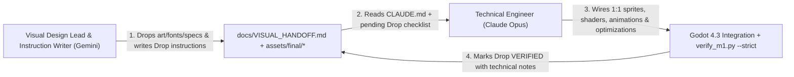

# شعلة — SHAALA

**أثر النور في الرماد • Embers of Forgotten Memory**

`Godot 4.3+` · `Typed GDScript` · `Arabic-First RTL + English` · `1920×1080 @ 60 FPS` · `Milestone 0.1.0-M1`

---

## عن اللعبة | Premise & Themes

**العربية:**  
**«شعلة»** لعبة مغامرات واستكشاف ثنائية الأبعاد بأسلوب فني مرسوم يدويًا (Painterly 2D Metroidvania)، تدور أحداثها في **الرياض الخالية المهدّمة عام ٢٠٥٤**، مستلهمةً بروحها وموضوعاتها ومعالمها من رواية *«شعلة»* في معالجةٍ إبداعية مستقلة. يستيقظ **فريد** داخل بيتِ شَعْرٍ في صحراء جنوب الرياض فاقدًا للذاكرة، يوقظه طفلٌ صغير برفقٍ بعصًا خشبية مناديًا إياه: **«أبي»**، وإلى جوارهما الناقة **أميرة** ودفترٌ ممزّق. قبل عشرين عامًا (٢٠٣٤)، أخلى شعاعٌ من النور المدينة بأكملها. كان فريد في ماضيه حارسًا لـ**المعقل** — عالمٍ كونيّ تتعلّق فيه الذكريات ككراتٍ ذهبية باهتة — فكسر البوابة التي تربطه بالأرض ليحيا حياةً عادية مع **إيثار** وطفله، ودفع ذاكرته ثمنًا لذلك. **كل قدرةٍ يستعيدها فريد في رحلته هي ذكرى تعود إليه.**

**English:**  
**SHAALA** (*"Flame"*) is an original 2D painterly action-exploration metroidvania built in **Godot 4.3**, set across a silent, emptied Riyadh twenty years after a blinding beam of light vanished its people in **2034**. Waking in a desert tent (*bayt al-sha'r*) with no memory, **Farid** is gently nudged awake by a small boy holding a wooden stick who calls him **"أبي"** (*Abi* / Father). Once the guardian of **the Citadel (*Al-Ma'qil* / المعقل)** where every memory hangs as a pale-gold orb, Farid shattered the gate between realms to choose an ordinary life with his wife **Ithar** and child — paying with his memory. Every ability unlocked across ruined Riyadh is a piece of his forgotten past returning.

### المحاور والقيم الفنية | Core Themes & Content Principles
- **الذاكرة والهوية / Memory & Identity:** What remains of a person when remembrance is stripped away?
- **ثمن اختيار العائلة على العالم / Family Over the World:** The quiet weight of choosing human love over cosmic duty.
- **الحزن في الصمت لا في الدموية / Grief in Silence, Not Gore:** Loss is conveyed through stillness, wind, and empty spaces — never graphic violence.
- **الأصالة والاحترام الثقافي / Authentic Saudi & Najdi Heritage:** Respectful, accurate portrayal of Najdi architecture (*shurfat*, *furjat*, *bayt al-sha'r*), Arabic heritage, faith, and Jinn folklore. The Beam Cult is strictly a fictional esoteric sect.
- **ألغازٌ مفتوحة عن قصد / Intentional Unanswered Mysteries:** Three threads remain open across the journey — the fate of the children and the uncle, who sits upon the distant throne, and the quiet man with the Arabic coffee cup (*finjan*).

---

## الهوية البصرية ولوحة الألوان | Painterly Visual Identity & Palette

SHAALA pairs **high-contrast dark silhouettes** with **soft hand-painted multi-layer parallax plates** (`1920×1080`, pixel-snapping OFF, 4 custom `canvas_item` shaders) grounded in Saudi desert and Najdi palettes (`assets/placeholder/palettes.gd` — `ShaalaPalette`):

| Swatch Constant | Hex | Visual Role |
| :--- | :---: | :--- |
| `MUD_BRICK_OCHRE` | `#C68B59` | Najdi mud-brick walls, Diriyah arches, Orb Shrine steles |
| `SUNSET_ORANGE` | `#E07A3C` | Desert dusk horizon, silhouette rim lights, Tier 0–1 flame core |
| `DESERT_RED` | `#A84432` | Red Nafud dunes, Farid's cloak trim, health ember pips |
| `NIGHT_INDIGO` | `#161B33` | Ruined Riyadh skyline, character silhouettes, translucent UI panels |
| `DEEP_SHADOW` | `#0D1021` | High-contrast foreground framing & grounded shadows |
| `PALE_GOLD_ORB` | `#F6E299` | Memory Orbs, Orb Shrines, Tier 2 Flame Dagger, Parry seal ring |
| `FARID_EYE_GREY` | `#8B95A5` | Farid's **left eye** (Citadel power / Grey Eye vision / Revenge ending) |
| `FARID_EYE_BLUE` | `#4A90D9` | Farid's **right eye** (Humanity & family / True ending) |
| `WARM_SAND_LIGHT` | `#E8C49A` | Sunlit dune edges, drifting sand veils, parchment highlights |
| `GLASS_TEAL` | `#4F6D7A` | Broken Riyadh glass towers, mall skylights, Shard Husks |

---

## النسخة التجريبية الأولى | Milestone 1 (Vertical Slice) Highlights

Milestone `0.1.0-M1` delivers a complete, verified playable slice spanning **3 areas (6 interconnected rooms)** with zero softlocks and zero dead ends:

- **World & Progression (6 Rooms):**
  - **Desert Camp (`desert_camp_01`, `desert_camp_02`):** Bedouin tent, The Boy (`أبي` opening dialogue), Camel Amira, Orb Shrine (`shrine_desert_camp`), Notebook Page #0, tutorials, Memory Orb #1 (**Dash**), and a `400 px` Dash-gated ravine with safe recovery ledges.
  - **Empty Highway (`empty_highway_01`, `empty_highway_02`):** Ruined Riyadh approach, abandoned vehicles, **Motaib** dual-greatsword overpass cameo, Dash-reachable Notebook Page #1, Memory Orb #2 (**Wall-Cling**), and a `220×520 px` pylon chimney.
  - **Empty Riyadh (`empty_riyadh_01`, `empty_riyadh_boss`):** Night-indigo shattered mall atrium, persistent two-way shortcut (`shortcut_riyadh_to_camp`) back to Desert Camp Shrine, 2-phase M1 Boss arena, Notebook Page #2, and the sealed Milestone 2 **Metro Tunnels** gate.
- **Tight Movement Physics:** `RUN_SPEED = 380`, `JUMP_VELOCITY = -640`, `0.12 s` coyote time & jump buffer, variable jump cut, `860 × 0.22 s` Dash, `130` wall-slide & `(440, -610)` wall-jump — with M2/M3 FSM states already wired for Double Jump, Ground-Pound, and Glide.
- **Resource-Driven Combat:** 3-hit directional **Flame Dagger** scaling across 3 tiers with the Flame Meter (`10`/`15`/`22` dmg, `72`/`96`/`124 px` reach), ranged **Flame Spell** (`25` Resource, `24` dmg), and **Parry** (`0.18 s` window, `+25` Resource, hitstop, `1.35×` stagger window).
- **Enemies & Boss:** `Sand Stalker` (35 HP), `Shard Husk` (45 HP, parry-reflectable shard), `Relic Sentinel` (75 HP, frontal tower shield), and **حارس البرج المتصدع — The Fractured Spire Warden** (280 HP, 2 phases).
- **Arabic-First RTL & Accessibility:** Boots in Modern Standard Arabic (`ar`) with live switching to English (`en`), HarfBuzz Arabic shaping via Godot 4 Advanced Text Server, BiDi numeral/keycap isolates, 125 UTF-8 keys (`0` hardcoded UI strings), atomic JSON saves (`user://saves/slot_0.json`), live key rebinding, Screen Shake scale, Reduce Flash, Game Speed Assist (`0.7×–1.0×`), and Gamepad Deadzone controls.
- **Verification Baseline:** `96/96` M1 deliverables, `632/632` statically typed GDScript functions, `22/22` strict automated checks (`verify_m1.py --strict`), and verified clean Godot 4.3 headless `--import` and scene boot.

---

## التشغيل السريع | Quickstart

### Prerequisites
- **Godot Engine 4.3+** (Standard / GDScript edition)
- **Python 3.10+** (for the automated QA & geometry verification suite)

### 1. Open & Play in Godot 4.3+
```bash
# Clone the repository
git clone https://github.com/<owner>/shaala.git
cd shaala

# Launch in Godot Editor (or run directly)
godot --path . --editor
# Or play immediately:
godot --path .
```

### 2. Run Automated Verification & Headless Checks
```bash
# Full 6-section static, contract, localization, and ballistic-geometry audit:
python3 tools/verify_m1.py --strict

# Real Godot 4.3 headless import & 3-second boot sanity check:
godot --headless --path . --import --quit
godot --headless --path . --quit-after 3
```

### Controls (Keyboard & Gamepad)
All keyboard bindings are live-rebindable in **Pause → Settings → Controls** (`الإعدادات → التحكم`).

| Action | Keyboard | Gamepad | Notes |
| :--- | :--- | :--- | :--- |
| Move Left / Right | `A` / `D` or `←` / `→` | Left Stick / D-Pad | Full horizontal control |
| Look / Aim Up & Down | `W` / `S` or `↑` / `↓` | Left Stick / D-Pad | Up-slash, aerial down-pogo |
| Jump / Wall-Jump | `Space` or `Z` | `A` / Cross | Variable height, coyote & buffer |
| Dash | `Shift` or `L` | `RB` or `B` / Circle | Unlocked via Memory Orb #1 |
| Flame Dagger Attack | `J` or `X` | `X` / Square | 3-hit directional combo, scales with Flame Meter |
| Ranged Flame Spell | `K` or `C` | `RT` | Costs 25 Flame Resource |
| Parry | `F` | `LB` | `0.18 s` window; staggers attackers & restores +25 Resource |
| Interact / Talk / Rest | `E` | `Y` / Triangle | Shrines, Orbs, Pages, NPCs, Shortcuts |
| Grey Eye *(M2)* | `Q` | `LT` | Architectural hook active in M1 |
| Time Shift *(M2)* | `T` | `R3` | `Era2034` / `Era2054` room toggle at anchors |
| Toggle Minimap | `M` or `Tab` | `Select` / View | Explored rooms, Shrine & Boss markers |
| Pause / Notebook / Settings | `Esc` | `Start` / Options | Torn Notebook viewer, Language AR/EN, Accessibility |

---

## سير العمل التعاوني | Two-Agent Workflow (Gemini ↔ Claude Opus)

This repository uses a clean, structured **two-agent creative + engineering workflow** so visual production and Godot 4.3 engineering stay decoupled, reproducible, and conflict-free:



| Role | Agent | Primary Ownership |
| :--- | :--- | :--- |
| **Visual Design Lead & Instruction Writer** | **Gemini** | Hand-drawn 2D art direction, `ShaalaPalette` & Najdi motifs, `docs/ART_SPEC.md`, production drops under `assets/final/` (spritesheets, parallax plates, UI ornaments, OFL Arabic fonts), and writing structured Drop briefs in `docs/VISUAL_HANDOFF.md`. |
| **Technical Engineer** | **Claude Opus** | Godot 4.3 engineering (`CLAUDE.md`): 1:1 scene integration (`.tscn`), typed GDScript (`scripts/`), `canvas_item` shaders, data schemas (`data/`), RTL/BiDi UI & `localization/strings.csv`, performance optimization, and enforcing `verify_m1.py --strict` + Godot headless verification. |

> **Starting a session as Claude Opus?** Read [`CLAUDE.md`](CLAUDE.md) first, then inspect open entries in [`docs/VISUAL_HANDOFF.md`](docs/VISUAL_HANDOFF.md).

---

## هيكل المشروع | Repository Layout

```text
shaala/
├── project.godot              # Godot 4.3 config (1920x1080, 60 TPS, snap OFF, ar locale, 5 autoloads)
├── README.md                  # Bilingual Arabic-first + English overview & workflow guide
├── CLAUDE.md                  # Technical Engineer manual & Godot 4.3 guardrails for Claude Opus
├── CHANGELOG.md               # Keep-a-Changelog milestone history
├── assets/
│   ├── placeholder/           # M1 ShaalaPalette, 4 painterly .gdshader files, UI theme
│   └── final/                 # 1:1 drop-in target for final hand-drawn PNGs & OFL Arabic fonts
├── data/                      # abilities.json, rooms.json, enemies.json
├── docs/                      # GDD, WORLD_GRAPH, ART_SPEC, VISUAL_HANDOFF, M1_TASK_BREAKDOWN, QA_NOTES, KNOWN_ISSUES
├── localization/              # strings.csv (125 UTF-8 MSA Arabic + English keys) & localization README
├── scenes/
│   ├── main.tscn              # Entry point (RoomManager + UIRoot + FadeLayer)
│   ├── player/                # Farid rig & FlameProjectile
│   ├── enemies/ & boss/       # 3 M1 enemies & The Fractured Spire Warden
│   ├── interactables/         # OrbShrine, MemoryOrb, NotebookPage, NpcBoy/Motaib, CamelAmira
│   ├── rooms/m1/              # All 6 interconnected M1 rooms
│   └── ui/                    # TitleScreen, HUD, VignettePlayer, MinimapOverlay, PauseSettingsMenu
├── scripts/                   # Strictly typed GDScript (autoload, systems, combat, player, enemies, boss, interactables, rooms, ui)
└── tools/
    └── verify_m1.py           # Automated 6-section verification & ballistic playtest-simulation harness
```

---

## فهرس التوثيق | Documentation Index

| Document | Purpose |
| :--- | :--- |
| [`CLAUDE.md`](CLAUDE.md) | Technical Engineer handbook for Claude Opus (contracts, solved Godot 4.3 pitfalls, verification gate) |
| [`docs/VISUAL_HANDOFF.md`](docs/VISUAL_HANDOFF.md) | Living Gemini → Claude Opus visual drop queue, Drop template, and `DROP-001` baseline manifest |
| [`docs/GDD.md`](docs/GDD.md) | Full Game Design Document (narrative, physics constants, combat, Time Shift, Grey Eye, Don't-Look, endings) |
| [`docs/WORLD_GRAPH.md`](docs/WORLD_GRAPH.md) | Complete 14-area world graph, gate/shortcut matrix, zero-dead-end proof, 12 Notebook Pages, 6 M1 rooms |
| [`docs/ART_SPEC.md`](docs/ART_SPEC.md) | Exhaustive 1:1 illustrator replacement manifest (canvas px, frames, pivots, shaders, parallax layers) |
| [`docs/M1_TASK_BREAKDOWN.md`](docs/M1_TASK_BREAKDOWN.md) | Milestone 1 task breakdown, ownership boundaries, cross-system contracts, and Definition of Done |
| [`docs/QA_NOTES.md`](docs/QA_NOTES.md) | Milestone 1 QA verification metrics, resolved defects log, and interactive playtest script |
| [`docs/KNOWN_ISSUES.md`](docs/KNOWN_ISSUES.md) | Runtime watchlist and intentional M1 → M5 scope boundaries |
| [`assets/final/README.md`](assets/final/README.md) | Illustrator export settings (PNG-32, alpha border fix, naming rules) and Godot 1:1 swap instructions |
| [`localization/README.md`](localization/README.md) | Arabic-first MSA localization workflow, RFC-4180 CSV rules, and RTL/BiDi conventions |
| [`CHANGELOG.md`](CHANGELOG.md) | Release and milestone history (`[0.1.0-M1]` and planned M2 roadmap) |

---

## خارطة الطريق | Milestone Roadmap

| Milestone | Scope | Status |
| :---: | :--- | :---: |
| **M1** | Vertical Slice: 3 areas (6 rooms + shortcut), core movement + Dash + Wall-Cling, 3-tier Flame Dagger/Spell/Parry, 3 enemies + Spire Warden boss, Shrine save/load, Arabic-first RTL UI | **Complete (`0.1.0-M1`)** |
| **M2** | Active Time Shift (`2034` ↔ `2054`), Grey Eye vision, Diriyah/At-Turaif + Metro Tunnels, expanded map, 2 bosses | Planned |
| **M3** | All 14 areas greyboxed with full ability gating, Don't-Look Jinn zones, Motaib mid-game boss duel | Planned |
| **M4** | Full narrative pass, all 12 Torn Notebook Pages, Citadel merge climax, Revenge & True Endings (2034 Stadium) | Planned |
| **M5** | Final hand-drawn art integration via `VISUAL_HANDOFF.md`, oud/strings audio mastering, juice, polish, 60 FPS pass | Planned |
