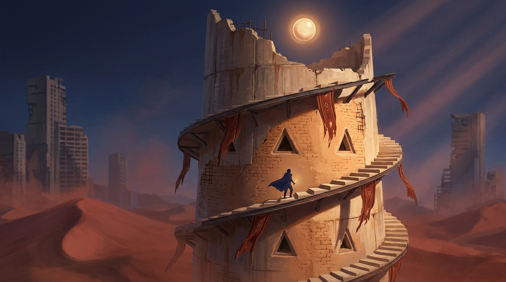
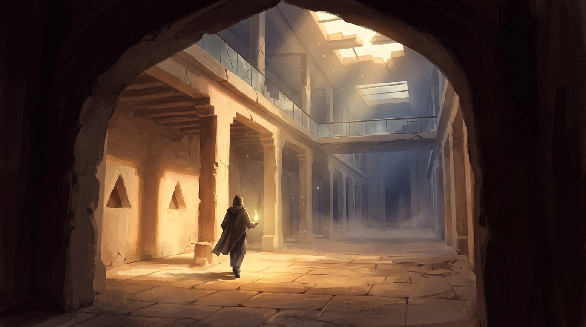

# شعلة (SHAALA) — النقد الفني والمكاني الصريح للفصل الأول وخطة الأبعاد الجديدة
# Brutal Artistic & Spatial Critique of Chapter 1 & 2.5D Pipeline Blueprint

**التاريخ / Date:** 2026-11-27  
**النطاق المدقّق / Audited Build:** `0.1.0-M1` (لقطة `docs/ui_audit/03_hud_ar.png`، جميع غرف الفصل الأول الست `scenes/rooms/m1/*.tscn`، نظام `scripts/world/playable_block.gd`، هيكل فريد في `scripts/player/player.gd`، وخطط `docs/ART_SPEC.md` و`docs/UI_DESIGN_PLAN.md`)  
**منهج النقد / Critique Standard:** نقد استوديو صريح بلا مجاملة — تشخيص بصري ومكاني لما هو مبنيّ فعليًا على القرص اليوم، لا لما نأمله على الورق.

---

## ١. النقد الفني الصريح للفصل الأول — Brutal Chapter 1 Art Audit

رغم أن البنية التقنية للنسخة التجريبية الأولى (`M1`) صلبة ومتماسكة (60 إطارًا، فيزياء دقيقة، 0 أخطاء مضلعات، وتعريب كامل)، فإن **الصورة الفعلية على الشاشة في الفصل الأول لا تزال تبدو كـ «مجسّمات كرتونية مسطّحة تنزلق جانبيًا»** بدلًا من عالمٍ سعوديّ مرسوم يدويًا يتنفس بالضوء والعمق والرهبة. التشخيص أدناه يفكك المشكلة عبر ستة محاور حاسمة.

### ١.١ هرمية الظلال والقيم الضوئية والتباين — Silhouette, Value & Contrast Hierarchy
- **توحّد القيم اللونية بين الطبقات (Value Mudding):** في لقطة `docs/ui_audit/03_hud_ar.png`، تظهر أبراج الرياض البعيدة في الطبقة الخلفية (`FarLayer`) بقيمة داكنة شبه مطابقة لظل بيت الشعر في الطبقة الأمامية (`#161B33`). النتيجة المباشرة: ينهار الإحساس بالمسافة؛ العين لا تقرأ أن المدينة تبعد كيلومترات عن المخيم، بل تراها كقطعة ورق سوداء ملتصقة خلف المزار مباشرةً.
- **مأزق «المستطيلات المرسومة» في `PlayableBlock`:** رغم استبدال المستطيلات الفارغة بستة أنماط إجرائية في `scripts/world/playable_block.gd` (`sand_dune_ground`, `najdi_mudbrick_ruin`, `collapsed_building`, `broken_highway_deck`, `abandoned_car_platform`, `cracked_glass_bridge`)، يظل الأساس الهندسي لكل كتلة هو `draw_rect(rect, ...)` بحدود عمودية وأفقية صارمة بزاوية `90°` وشريط علوي موحّد بسماكة `5 px`. العين تكشف فورًا «الصندوق» خلف الزخرفة الإجرائية، فتبدو المنصات مثل `PracticeRockLow` و`PracticeRockHigh` كصناديق خشبية مصفوفة لا كصخورٍ نجدية نحتتها الرياح.
- **انكسار تدرّج السماء (`SkyLayer`):** السماء في `desert_camp_01` مقسّمة إلى أشرطة أفقية حادة (كحلي داكن في الأعلى، ثم قرميدي، ثم برتقالي فاقع)، مع قرص شمسٍ مضلّع خشن سداسي الحواف يفتقر لأي توهّج جوي (Bloom/Haze). هذا يكسر الوهم اللوني فورًا ويجعل الأفق يبدو رقميًا بدائيًا لا لوحة غواش.
- **تشويش خط الأفق بتكرار الشواهد:** صفُّ أربعة شواهد تعليمية متطابقة (`TutorialSign`) على استقامة واحدة فوق أرضية مسطحة في `desert_camp_01` يخلق إيقاعًا متكررًا يُشبه «أعمدة سياج» ويزاحم بصر اللاعب عن نقطة الجذب الحقيقية: بيت الشعر، أميرة، ومزار الكرة (`OrbShrineCamp`).

### ١.٢ الإضاءة والمنظور الجوي — Lighting & Atmospheric Perspective
- **غياب أشعة الضوء الاتجاهية (Zero Directional Dusk Shafts):** لا يوجد مصدر ضوء اتجاهي حقيقي يربط السماء بالأرض. لا توجد حزم غبار غروبية مائلة تخترق فتحات الجسور (`empty_highway_01`) أو أسقف المجمع المهدم (`empty_riyadh_01`).
- **غياب الإضاءة المرتدّة والظلال التلامسية (No Bounce Light & Zero Ambient Occlusion):**
  - قاعدة بيت الشعر، ركبتا الناقة أميرة، قاعدة مزار الكرة، وكتل `PlayableBlock` تلتقي بالأرض عند خطٍ مستقيمٍ حادّ بلا أي تظليل تلامسي (`Ambient Occlusion`) أو غبار متراكم عند الحواف السفلية.
  - الرمال الحمراء النجدية عند الغروب تعكس توهّجًا نحاسيًا دافئًا على الجوانب السفلية للصخور والسيارات المهجورة؛ في النسخة الحالية، الأجزاء السفلية للكتل مطفأة بلونٍ داكنٍ بارد موحّد بلا أي انعكاس دافئ.
- **فراغ الأرضية السفلية (Dead Terracotta Slab):** أسفل خط المشي في `desert_camp_01` تشغل كتلةٌ حمراء صمّاء قرابة `18%` من ارتفاع الشاشة دون تدرّجٍ لونيٍّ نحو العمق، ودون إطارِ ظلٍّ أمامي (`Foreground Framing`) يُركّز العين داخل المشهد.

### ١.٣ المقياس والضخامة المعمارية — Scale & Architectural Monumentality
- **تقلّص الإحساس بالرهبة (Lost Monumentality):** يبلغ طول كبسولة فريد `28 × 62 px` على شاشة `1920 × 1080`. حين يقف فريد أمام دعامات الطريق السريع في `empty_highway_01` (`camera_bounds = 3200 × 1080`) أو أعمدة المجمع الزجاجي في `empty_riyadh_01`، تبدو العمارة منخفضة ومضغوطة لأن ارتفاع الكاميرا مقفول على شريطٍ أفقيٍّ ضيّق نسبيًا، كما أن سماكة الأعمدة الخلفية لا تتباين دراميًا بما يكفي لتصغير فريد وإبراز عظمة المدينة المهجورة حوله.
- **تجانس مقياس التفاصيل:** حجارة `najdi_mudbrick_ruin` وشقوق `collapsed_building` مرسومة بحجمٍ بصري متقارب في كل الغرف، فلا يشعر اللاعب بنقلةٍ صادمة في المقياس عند انتقاله من حميمية المخيم الصحراوي إلى جلال جسور الرياض الخرسانية ثم فراغ السقف الزجاجي المحطّم.

### ١.٤ حضور الشخصية والارتكاز الأرضي — Character Presence & Grounding
- **ابتلاع فريد داخل الظلال (`player.tscn` مقابل الخلفيات الداكنة):** رغم أن إعادة تصميم فريد إلى هيكل مفصلي من 16 جزءًا (`player.gd`) حسّنت الحركة بوضوح، فإن معطفه الكحلي الليلي (`#161B33`) يذوب تمامًا داخل بيت الشعر الداكن في `desert_camp_01` (كما يظهر بوضوح في `03_hud_ar.png` حيث لا يكاد يُرى إلا عيناه ووشاحه)، كما يضيع أمام واجهات `collapsed_building` الكحلية في الرياض الخالية لعدم وجود حافة ضوء ديناميكية كافية (`rim_strength`) تفصله عن الخلفيات المظلمة.
- **انعدام ظلّ التلامس الأرضي (Floating Feet):** لا يوجد ظلّ بيضاوي ناعم يتبع قدمي فريد ويتقلّص مع ارتفاع القفز؛ هذا يفقد الشخصية جزءًا كبيرًا من «الثقل البصري» عند الهبوط والاندفاع.
- **ازدحام الخلفية خلف الكتل:** عندما تتراكب خطوط التصدّع الإجرائية في `PlayableBlock` خلف فريد أثناء القتال السريع، تتنافس التفاصيل الهندسية مع حركات خنجر الشعلة.

### ١.٥ التسطّح المكاني — Spatial Flatness (The Single-Plane Problem)
هذا هو **أعمق عيب فني-تصميمي في الفصل الأول حاليًا**:
- كل الغرف الست (`desert_camp_01` حتى `empty_riyadh_boss`) تجري فوق **مستوى Z واحد صارم (Single Flat Z-Plane)** بحركة يسار↔يمين تقليدية فقط.
- طبقات الـ `ParallaxBackground` تتحرك خلف اللاعب فقط؛ **لا يوجد عنصر معماري ضخم يعبر أمام فريد لحجبه جزئيًا ثم كشفه (Foreground Occlusion)**، ولا يدخل فريد أبدًا داخل بوابةٍ نجدية غائرة إلى ممرٍّ داخليٍ أعمق، ولا تدور الكاميرا حول معلمٍ دائريٍّ مهيب.
- النتيجة: بعد 5 دقائق من اللعب، يقرأ الدماغ العالم كـ «مسرح عرائس ثنائي الأبعاد» بدلًا من مدينة ثلاثية الأبعاد ذات عمقٍ وكتلةٍ وفراغاتٍ حقيقية.

### ١.٦ تفكيك الغرف الست غرفةً بغرفة — Room-by-Room Tear-Down (M1)

| الغرفة / Room | الأبعاد والطبقات الحالية | نقاط الضعف البصرية والمكانية الملموسة | الإصلاح البصري الجوهري المطلوب |
| :--- | :--- | :--- | :--- |
| **`desert_camp_01`** | `2600×1080` · 5 طبقات Parallax · 9 كتل `PlayableBlock` (`sand_dune_ground`, `najdi_mudbrick_ruin`) | فريد يختفي داخل بيت الشعر المظلم؛ أربعة شواهد تعليمية مكررة تقطع خط الأفق؛ شمس مضلّعة جافة؛ نخلة هندسية قاسية؛ أبراج الرياض البعيدة داكنة جدًا بلا ضباب مسافة. | إضاءة فانوس دافئة مرتدة داخل بيت الشعر؛ دمج التعليمات في البيئة بدل تكرار الشواهد؛ تدرج سماء غواش متصل مع توهّج شمسٍ ناعم؛ تفتيح أبراج الرياض بضباب رملي (`#C68B59` 55%)؛ ظل تلامسي تحت الخيمة وأميرة والمزار. |
| **`desert_camp_02`** | `2800×1080` · 5 طبقات · 9 كتل + 3 `DeepSandZone` + `ChasmGustWind` | الهوة البالغة `400 px` تبدو كقطعٍ حادّ بين مستطيلين بدل وادٍ رملي متآكل؛ قاع الوادي مسطحٌ بلا عمقٍ يمتد للخلف؛ مناطق الرمل العميق تحتاج تدرّج غرق بصري أوضح بين الرمل الجاف والناعم. | إضافة جدران وادٍ خلفية غائرة (`FarCanyonWall`)؛ تدرج ظلٍّ عميق داخل الهوة (`Gradient AO`)؛ إضافة حواف صخرية مائلة تذيب الزاوية القائمة لحافة القفز. |
| **`empty_highway_01`** | `3200×1080` · 5 طبقات · 13 كتلة (`abandoned_car_platform`, `broken_highway_deck`, `collapsed_building`) | جسر متعب (`MotaibOverpassDeck`) يقرأ ككتلة مستطيلة عائمة؛ السيارات المهجورة (`AbandonedCar1/2`) مسطّحة التظليل بلا ظلال سفلية على الإسفلت؛ غياب أشعة الغروب المائلة بين دعامات الجسر. | إضافة أعمدة جسر أمامية داكنة (`z_index = 15`) تمر أمام الكاميرا لإحساس السرعة والضخامة؛ أشعة غبار مائلة بزاوية `28°` تضيء وقفة متعب؛ إضاءة مرتدة دافئة أسفل هياكل السيارات. |
| **`empty_highway_02`** | `2600×1400` · 5 طبقات · 6 كتل + 2 `CrumblingLedge` + `ChimneyUpdraftWind` | مدخنة القفز الجداري (`ChimneyLeftPylon` / `ChimneyRightPylon`, عرض `220 px`, ارتفاع `520 px`) تبدو كممرٍّ مستطيل مغلق بلا عمقٍ معماري خلفها؛ الانتقال بين المستوى السفلي والطريق الدائري العلوي يفتقر إلى تباين إضاءة درامي (ظل عميق أسفل ↔ أفق مفتوح أعلى). | تدرّج ظلمة أسفل الجسر إلى توهج شفقٍ برتقالي-نيلي في القمة؛ إظهار دعامات دائرية بعيدة في الفراغ خلف المدخنة؛ جسيمات غبار صاعدة مع تيار الهواء (`ChimneyUpdraftWind`) تقود العين للأعلى. |
| **`empty_riyadh_01`** | `3400×1280` · 5 طبقات · 14 كتلة (`cracked_glass_bridge`, `collapsed_building`) + 2 `CrumblingLedge` | رغم ثراء المسار العمودي، يظل البهو الزجاجي مسطحًا على مستوى Z واحد؛ الزجاج المكسور يفتقر إلى لمعان مائل وانعكاسات باردة؛ لا يوجد إحساس بالدخول الفعلي *داخل* رواق المجمع المهجور. | **إدخال بُعد العمق الداخلي (`DepthPlanePortal`)**: ممر داخلي غائر (`z_index = -5`, مقياس `0.76`) تمر أمامه 3 أعمدة أمامية داكنة (`z_index = 15`) وحزم ضوء ذهبية (`z_index = 12`)، بالإضافة إلى بوابة البرج الحلزوني ثلاثي الأبعاد (`pillar_orbit_spire`). |
| **`empty_riyadh_boss`** | `2200×1080` · **4 طبقات فقط (بلا `WindLayer`)** · 7 كتل | الساحة تفتقر لطبقة الغبار/الرياح العائمة التي تمنح الهواء حياة؛ الخلفية الزجاجية المحطمة مسطحة خلف **حارس البرج المتصدع**؛ الشرفات الزجاجية (`GlassBalconyWest/East`) تبدو كرفوف معلّقة بلا أعمدة حاملة خلفية. | إضافة طبقة غبار زجاجي ناعم (`sand_wind` بلون `#4F6D7A`, `density = 0.16`)؛ حزمة ضوء قمرية/ذهبية عمودية من السقف المحطّم تُسلَّط على مركز الساحة وتشتد في المرحلة الثانية؛ إضافة دعامات خلفية غائرة للشرفات. |

---

## ٢. المرجعية الفوتوغرافية السعودية والرياضية الحقيقية — Photo Referencing

لرفع «شعلة» من «رسوم إجرائية نظيفة» إلى **لوحة فنية لا يمكن أن تنتمي إلا للرياض ونجد**، يجب استلهام الإضاءة والخامة والنِّسَب من خمس مرجعيات فوتوغرافية سعودية حقيقية — مع الالتزام الصارم بقاعدة **D6 (صفر معالم حقيقية مدمَّرة كبرج المملكة أو الفيصلية؛ أشكال معمارية أصلية مستلهمة الروح فقط)**:

| # | المرجعية الفوتوغرافية السعودية | سلوك الضوء واللون الحقيقي (Lighting & Palette) | الخامة والنِّسَب المعمارية (Texture & Proportion) | التطبيق المباشر داخل الفصل الأول وما بعده |
| :-: | :--- | :--- | :--- | :--- |
| **١** | **رمال النفود والرمال الحمراء قرب الرياض (الساعة الذهبية والزرقاء)** *Red Sands / Nufud at Golden & Blue Hour* | تحوّلٌ لونيٌّ درامي من أحمر أكسيد الحديد النحاسي (`#A84432` → `#E07A3C`) على الوجه المواجه للشمس، إلى ظلالٍ بنفسجية-نيلية عميقة (`#161B33`) على الوجه المظلّل للكثيب؛ حافة قمة الكثيب تلمع كشفرة ضوء ذهبية حادة (`#F6E299`)، مع ظلالٍ طويلة جدًا منخفضة الزاوية. | تموّجات رملية دقيقة متوازية تحفرها الرياح؛ انسياب ناعم بلا زوايا `90°` مطلقًا؛ انتقال تدريجي بين الرمل المتماسك الداكن والرمل الناعم العميق. | إعادة تشكيل تدرّج سماء `desert_camp_01/02`، وإضافة حواف رملية مائلة وانعكاس نحاسي دافئ على الجوانب السفلية للصخور والسيارات. |
| **٢** | **جبال طويق وحافة العالم** *Tuwaiq Escarpment* | إضاءة جانبية دافئة تكشط الطبقات الجيرية الأفقية فتُضيء الحواف البارزة بالأوكر الرملي (`#E8C49A`) بينما تغرق الشقوق الأفقية في ظلٍ أزرق-نيلي بارد؛ ضباب الوادي السفلي يفصل الجرف القريب عن السهل اللانهائي بوضوحٍ جويٍّ مذهل. | صخور رسوبية متدرّجة أفقيًا (`Stratified Limestone`) بواجهات عمودية مهيبة تتقزّم أمامها قامة الإنسان بنسبة `1 : 12` على الأقل. | خلفية `FarLayer` في المخيم والطريق السريع، وأساس صياغة كتل الصخور النجدية ومستوى `Edge of the World` في M3. |
| **٣** | **عمارة الطريف والدرعية الطينية النجدية** *At-Turaif / Diriyah Mud-Brick Architecture* | الضوء الجانبي المنخفض يكشف ملمس اللياسة الطينية المخلوطة بالتبن (مسامات وظلال مجهرية دافئة `#C68B59` ↔ `#6E4930`)؛ الأزقة المقوّسة وفتحات الـ **فرجات (*Furjat*)** تكون شديدة الظلمة من الداخل فتؤطّر ساحاتٍ مشرقةً خلفها بتباينٍ بصريٍ آسِر. | جدران سميكة مائلة قليلًا للداخل كلما ارتفعت (ليست عمودية هندسيًا)، تتوجها شرفات مثلثة متدرجة (*Shurfat*)، وعتبات خشبية داكنة من جذوع الأثل. | ترقية `najdi_mudbrick_ruin` و`OrbShrine` من مستطيلاتٍ صلبة إلى كتلٍ مائلة قليلاً بفتحات غائرة وعمقٍ مظلمٍ حقيقي، وتصميم الممرات الغائرة (`DepthPlanePortal`). |
| **٤** | **جسور الرياض الخرسانية والطرق الدائرية** *Riyadh Concrete Highway Viaducts & Ring Roads* | أعمدة خرسانية ضخمة تنحني بانسيابية لتصنع «أودية حضرية» تخترقها حزم غبارٍ غروبية مائلة بزاوية `25°–35°`؛ تباينٌ هائل بين الخرسانة الرمادية الدافئة بالغبار تحت الشمس، والظلّ الكحلي العميق أسفل سطح الجسر. | نسبٌ مهيبة (العمود الواحد يعادل `2.5–3×` عرض الإنسان و`10×` طوله)؛ فواصل تمدّد متكررة، حواجز خرسانية متصدعة، وإشارات طرق مائلة بلا شعارات حقيقية. | إصلاح المقياس في `empty_highway_01/02`، وإدخال أعمدة جسر أمامية عابرة (`z_index = 15`) وحزم غبارٍ مائلة، ثم الجسر الحلزوني ثلاثي الأبعاد. |
| **٥** | **الأبهاء الحديثة من الزجاج والخرسانة** *Modern Glass-and-Concrete Atriums (Original Forms — D6)* | انعكاسات فيروزية باردة (`#4F6D7A`) على الواجهات الزجاجية الستائرية تخترقها أعمدة ضوءٍ ذهبية متربة نازلة من سقفٍ زجاجي متشقق؛ تباينٌ شاعريٌّ بين برودة الزجاج المهجور ودفء الغبار الصحراوي الزاحف للداخل. | شبكات ألمنيوم منتظمة مكسورة بفتحات غير متماثلة، ممرات معلّقة متعددة الطوابق، وأعمدة أسطوانية مكسوّة بالرخام والزجاج (أشكال أصلية 100% بلا أي معلم حقيقي). | قلب الهوية البصرية لـ `empty_riyadh_01` و`empty_riyadh_boss` وتجربة الممر الداخلي الغائر والبرج الدائري. |

---

## ٣. إضافة أبعاد مكانية جديدة — New Spatial Dimensions Design (2.5D & Blender Pipeline)

لكسر رتابة «الحركة الأفقية على مستوى واحد» دون التضحية بدقة تحكّم الميترويدفانيا ثنائية الأبعاد (`60 FPS`، قفز وصدّ دقيقان)، نُدخل **ثلاثة أبعاد مكانية متدرّجة** تجمع بين قدرات Godot 4.3 الأصلية (`Node3D` + `Camera3D`) وعمق الطبقات ثنائية الأبعاد وخط إنتاج Blender:

### ٣.١ البُعد الأول — صعود البرج الأسطواني الدوّار (`pillar_orbit_spire.tscn`)

- **المفهوم المكاني:** برجٌ دائريٌّ مهيب من العمارة الرياضية-النجدية المهدمة (أعمدة خرسانية متكسرة وشرفات طينية وزجاج مكسور) يلتف حوله مسارٌ لولبيّ بزاوية **`360°` كاملة** (انظر لوحة المرجع [`ref_01_pillar_orbit.jpg`](ch1_references/ref_01_pillar_orbit.jpg)).
- **الآلية والتنفيذ في Godot 4.3:**
  - مشهد `Node3D` مستقل يُستدعى بسلاسة عبر `RoomManager` (من بوابة البرج الشرقي في `empty_riyadh_01` أو عبر اختصار التجربة السريع `F3`).
  - يتحرك فريد حول محيط الأسطوانة بإحداثيات قطبية `(angle_rad, height_y, radius)` مع نفس شعور الجاذبية والقفز والاندفاع (`Dash`)؛ بينما تدور `Camera3D` تلقائيًا حول المحور المركزي للبرج، فينكشف أفق الرياض الغروبي بزاوية `360°` وتلتف المنصات الحجرية وتختفي خلف جسم البرج بعمقٍ ثلاثي الأبعاد حقيقي!
  - تُكسى الهندسة ثلاثية الأبعاد بـ `painterly_3d_toon.gdshader` (تظليل سِل/غواش بضربات فرشاة وحافة ضوء دافئة `#E07A3C` وظلال نيلية `#161B33`) حتى تندمج الأشكال ثلاثية الأبعاد بصريًا مع فريد ثنائي الأبعاد بلا أي تنافر.

### ٣.٢ البُعد الثاني — الممرات الداخلية بعمق Z (`DepthPlanePortal` في `empty_riyadh_01.tscn`)

- **المفهوم المكاني:** بدل أن يمشي فريد *أمام* قوس المجمع المهجور فقط، يمكنه الوقوف عند بوابة مكسورة والضغط على التفاعل (`E`) **للدخول في العمق (`Z-Depth`)** إلى رواق داخلي غائر تضيئه حزم غبارٍ ذهبية (انظر لوحة المرجع [`ref_02_depth_archway.jpg`](ch1_references/ref_02_depth_archway.jpg))، فتمر **ثلاثة أعمدة أمامية ضخمة (`z_index = 15`) أمام فريد مباشرةً** لتحجبه لحظيًا وتصنع إحساسًا سينمائيًا مذهلًا بالعمق والاحتواء.
- **العقد البصري والحركي:**
  - عند الدخول إلى `"interior"`: ينساب فريد خلال `0.38 s` (`Cubic Ease-In-Out`) إلى مقياس `0.76×`، مع إزاحة لونية جوية غبارية (`Color(0.78, 0.78, 0.88, 1.0)`) وعمق `z_index = -5` خلف الأعمدة الأمامية (`z_index = 15`) وحزم الضوء (`z_index = 12`).
  - عند الخروج إلى `"foreground"`: يعود فريد بسلاسة إلى `scale = 1.0`, `modulate = WHITE`, `z_index = 0` (مع ضمان إعادة التصفير تلقائيًا في `RoomManager` عند تغيير الغرفة أو العودة للمزار).

### ٣.٣ البُعد الثالث — مسارات الكاميرا المنحنية 2.5D (مخطّط M2+)
- **المفهوم المكاني (Diriyah & Tuwaiq):** في المرحلة الثانية والثالثة، يمكن استخدام `Path3D` منحنٍ للمنصّات الدائرية على جسور الطريق الدائري وحواف طويق، حيث تنحرف `Camera3D` بزاوية `15°–28°` (ثلاثة أرباع المنظور `3/4 Vista`) لتكشف امتداد الوادي أو السوق القديم أمام اللاعب قبل أن يصل إليه، مع إبقاء التحكم ثنائي الاتجاه على طول المنحنى (`left/right` على طول المسار) لضمان دقة القتال والمنصات.

### ٣.٤ خط إنتاج Blender → Godot 4.3 للأبعاد 2.5D المرسومة يدويًا
لضمان أن تبدو المجسمات ثلاثية الأبعاد في البرج الدوّار ومشاهد M2+ وكأنها **لوحة غواش متحركة مطابقة لإطارات الأسلوب المعتمدة (`sf01` / `sf03`)** لا رسوم ثلاثية الأبعاد بلاستيكية:

1. **النمذجة في Blender (Low-Poly Faceted Silhouettes):**
   - بناء قطع معيارية بأسطح مشطوفة (Beveled / Faceted) تحاكي ضربات السكين اللوني (Palette Knife) — `300–1,500` مثلث لكل قطعة معيارية (`60 FPS` مضمون).
   - إمالة الجدران النجدية `3°–5°` للداخل وتنعيم زوايا الصخور؛ ممنوع تمامًا الصناديق الحادة `90°` بلا شطف.
2. **تخبئة التظليل اللوني في الرؤوس (Vertex-Color Ambient Occlusion):**
   - خبز `Ambient Occlusion` وتدرّج الغبار السفلي مباشرة داخل قناة `Color Attribute` (`COLOR.rgb` في الشيدر) بحيث تحمل قواعد الأعمدة والزوايا الداخلية ظلمة نيلية دافئة (`#0D1021`) تلقائيًا بلا تكلفة إضاءة ديناميكية ثقيلة.
3. **أقنعة الفرشاة اليدوية (UV Brush Masks):**
   - خامة واحدة خفيفة (`1024×1024`, `sRGB`) تحمل ملمس اللياسة الطينية/الخرسانة وضربات الفرشاة، تُقرأ داخل `painterly_3d_toon.gdshader` لكسر حدود الظل (Stepped Toon Ramp مع حافة فرشاة عضوية) وإضافة حافة ضوء غروبية (`Fresnel Rim`) بلون `#E07A3C` أو `#F6E299`.
4. **التصدير والاستيراد (`glTF 2.0 / .glb`):**
   - التصدير بصيغة `.glb` (`+Y Up`, `Apply Modifiers`, تضمين `Vertex Colors` و`Normals`، استثناء الكاميرات والأضواء).
   - تفعيل `Use External Material` في Godot 4.3 وربط خامة `painterly_3d_toon.gdshader` المشتركة لجميع الأسطح المعمارية.
5. **مواقع الإسقاط المباشر (Drop-In `.glb` Slots under `assets/final/meshes/`):**

| مسار الإسقاط (`assets/final/meshes/...`) | الاستخدام المستهدف | ميزانية المثلثات | الشيدر المربوط |
| :--- | :--- | :---: | :--- |
| `meshes/spire/pillar_core_segment.glb` | مقطع البرج الدائري المركزي في `pillar_orbit_spire.tscn` | `800–1,200` | `painterly_3d_toon.gdshader` |
| `meshes/spire/najdi_ledge_broken.glb` | منصات حجرية/نجدية ناتئة تلتف حول البرج | `250–450` | `painterly_3d_toon.gdshader` |
| `meshes/spire/shattered_arch_ring.glb` | قوس علوي متصدع وإطار قمة البرج | `600–900` | `painterly_3d_toon.gdshader` |
| `meshes/highway/curved_viaduct_pier.glb` | دعامات الجسر المنحنية لمشاهد M2 (2.5D Path) | `500–800` | `painterly_3d_toon.gdshader` |
| `meshes/riyadh/mall_column_occluder.glb` | أعمدة بهو أمامية ذات عمق حقيقي للرواق الغائر | `400–700` | `painterly_3d_toon.gdshader` |
| `meshes/diriyah/mudbrick_archway_depth.glb` | بوابات طينية عميقة لأزقة الدرعية (M2) | `600–1,000` | `painterly_3d_toon.gdshader` |

---

## ٤. خطة الارتقاء العملية للفصل الأول — Prioritized Actionable Upgrade Plan (P0 → P3)

| الأولوية | الحزمة / Upgrade Package | المالك المقترح | الأثر البصري الملموس | معيار القبول |
| :---: | :--- | :--- | :--- | :--- |
| **P0** | **كسر التسطّح المكاني في الفصل الأول:** إطلاق البرج الأسطواني الدوّار (`pillar_orbit_spire.tscn` + `painterly_3d_toon.gdshader` + اختصار `F3`) وتفعيل الممر الداخلي الغائر (`DepthPlanePortal` بأعمدة أمامية `z_index = 15` وحزم ضوء `z_index = 12`) في `empty_riyadh_01.tscn`. | `@art-shaders` + `@core-systems` | ينقل التجربة فورًا من شريط ثنائي الأبعاد مسطّح إلى عالمٍ متعدد الأبعاد والعمق. | قابل للعب بسلاسة في Godot 4.3 مع `0` أخطاء شيدر/مضلعات ونجاح `verify_m1.py --strict`. |
| **P1** | **إصلاح هرمية القيم والإضاءة والارتكاز:** (١) إضافة ظل تلامسي ديناميكي تحت فريد والـ NPCs والمزار؛ (٢) رفع إضاءة الحافة (`rim_strength`) لفريد وإضاءة فانوس دافئة داخل بيت الشعر حتى لا يضيع فريد في الظلال؛ (٣) تفتيح قيمة `FarLayer` بضباب المسافة؛ (٤) استبدال الشمس المضلّعة بتدرّج سماء متصل وتوهّج غروبي ناعم وإضافة `WindLayer` لغرفة البوس `empty_riyadh_boss`. | `@art-shaders` + `@player-combat` + `@level-builder` | يُصلح فورًا 80% من مشاكل لقطة `03_hud_ar.png` ويجعل القراءة البصرية سينمائية واضحة. | فريد مقروء بوضوح تام داخل بيت الشعر وأمام مباني الرياض؛ تباين واضح بين الخلفية والمقدمة. |
| **P2** | **كسر «صندوقية» التضاريس وتطبيق واجهة «دفتر وجمرة»:** (١) إضافة شطف عضوي وظلال `AO` سفلية وانعكاس رمل دافئ في `PlayableBlock` وتقليل الشواهد المكررة في `desert_camp_01`؛ (٢) تنفيذ خطة واجهة `UI_DESIGN_PLAN.md` (إزالة الصناديق العائمة، شريط السدو، خطوط `Reem Kufi` / `Aref Ruqaa` / `Readex Pro`، وتوحيد الأرقام العربية الهندية). | `@art-shaders` + `@ui-loc` | يزيل إحساس «المستطيلات البرمجية» من الأرضيات والواجهة معًا. | صفر صناديق UI عائمة في اللعب؛ تطابق بصري مع إطارات `sf01`/`sf03`. |
| **P3** | **إسقاط الأصول المرسومة يدويًا ومجسمات Blender (`.glb` + PNG-32):** استبدال لوحات الخلفيات (L0–L5) والسبرايتات عبر `docs/VISUAL_HANDOFF.md` (`DROP-001` Batches 1A–1E) وإسقاط نماذج `.glb` للبرج الدوّار وجسور M2 المنحنية. | **Gemini** (الأصول) + **Claude Opus** (التكامل) | الوصول إلى الجودة النهائية الجاهزة للنشر (Studio-Grade Painterly 2.5D). | استبدال 1:1 دون تعديل أي تصادم أو فجوة، مع الحفاظ على `60 FPS`. |
