# SHAALA (شعلة) — World Graph & M1 Room Layout

This document defines the full **14-area interconnected world graph** of *SHAALA*, its ability gates, shortcuts, critical path, all 12 Torn Notebook Page locations, a formal **zero-dead-end verification**, and the exact **6-room M1 Vertical Slice** specification.

---

## 1. Full 14-Area World Overview

| # | Area ID | English Name | Arabic Name | Milestone | Signature Mood & Mechanics |
| :-: | :--- | :--- | :--- | :-: | :--- |
| 1 | `desert_camp` | Desert Camp | مخيم الصحراء | **M1** | Sunset desert-red dunes, Bedouin tent (*bayt al-sha'r*), starting Orb Shrine, The Boy, Amira, Dash chasm. |
| 2 | `empty_highway` | Empty Highway | الطريق السريع الخالي | **M1** | Ruined multi-lane Riyadh approach, abandoned buses, Motaib cameo #1, Wall-Cling pylon chimney. |
| 3 | `empty_riyadh` | Empty Riyadh | الرياض الخالية | **M1** | Night-indigo broken skyscrapers, dead mall courtyard, M1 Boss (*Fractured Spire Warden*), loop shortcut to Camp. |
| 4 | `metro_tunnels` | Metro Tunnels | أنفاق المترو | **M2** | Sand-choked subterranean Riyadh metro lines beneath the mall; Double Jump unlock; Metro boss. |
| 5 | `diriyah` | Diriyah / At-Turaif | الدرعية / الطريف | **M2** | Mud-brick Najdi heritage fortress (*shurfat*, *furjat*); **Time Shift** unlock (`2034`/`2054`); Mirage Guardian boss. |
| 6 | `wadi_hanifa` | Wadi Hanifa | وادي حنيفة | **M2/M3** | Sunken canyon riverbed & palm shadows; **Grey Eye** unlock; first Don't-Look Jinn threshold; Motaib cameo #2. |
| 7 | `old_market` | Old Market | السوق القديم | **M3** | Collapsed Najdi *souq* arcades & cloth canopies; 2034/2054 shutter puzzles; central eastern hub. |
| 8 | `the_hideout` | The Hideout | المخبأ | **M3** | Quiet cellar beneath Farid & Ithar's house; unspoken family relics & safe sanctuary shortcut. |
| 9 | `the_library` | The Library | المكتبة | **M3** | Sunken archive of Beam Cult scrolls and pre-2034 records; **Ground-Pound** unlock; lore nexus. |
| 10 | `edge_of_the_world` | Edge of the World / Tuwaiq Cliffs | حافة العالم / جبال طويق | **M3** | Dramatic desert escarpment & updraft chasms; **Glide** unlock; **Motaib** mid-game boss duel. |
| 11 | `jinn_kingdom` | Jinn Kingdom | مملكة الجن | **M3** | Liminal subterranean mirage citadel governed by the **Don't-Look Rule**; Jinn Vizier boss; rift gate to the Citadel. |
| 12 | `stadium_2034` | 2034 Stadium *(Time Shift Only)* | ملعب ٢٠٣٤ | **M4** | Intact 2034 opening-night stadium reached exclusively via Time Shift anchor; True Ending epilogue site. |
| 13 | `the_citadel` | The Citadel (*Al-Ma'qil*) | المعقل | **M4** | Cosmic sanctuary of cracked glass floors beneath a sky of pale-gold memory orbs; **Grey-Eyed Other Self** duel & merge. |
| 14 | `memory_garden` | Memory Garden | حديقة الذكريات | **M4** | Quiet pale-gold garden beyond the merged Citadel; final choice between Revenge Ending and True Ending. |

---

## 2. Connected 14-Area World Graph (Mermaid)

```mermaid
flowchart LR
    A1["1. Desert Camp (M1)"]
    A2["2. Empty Highway (M1)"]
    A3["3. Empty Riyadh (M1)"]
    A4["4. Metro Tunnels (M2)"]
    A5["5. Diriyah / At-Turaif (M2)"]
    A6["6. Wadi Hanifa (M2-M3)"]
    A7["7. Old Market (M3)"]
    A8["8. The Hideout (M3)"]
    A9["9. The Library (M3)"]
    A10["10. Edge of the World / Tuwaiq Cliffs (M3)"]
    A11["11. Jinn Kingdom (M3)"]
    A12["12. 2034 Stadium (Time Shift Only - M4)"]
    A13["13. The Citadel / Al-Ma'qil (M4)"]
    A14["14. Memory Garden (M4)"]

    A1 <-->|"Dash (380px Chasm)"| A2
    A2 <-->|"Wall-Cling (Pylon Chimney)"| A3
    A3 -.->|"Unlockable Shortcut: shortcut_riyadh_to_camp"| A1
    A3 <-->|"Defeat Spire Warden (M1 Boss)"| A4
    A3 <-->|"Wall-Cling + Dash (North Bridge)"| A7
    A3 <-->|"Time Shift Anchor [2034 Only]"| A12

    A4 <-->|"Wall-Cling + Dash (West Line)"| A5
    A4 <-->|"Double Jump (Deep Shaft)"| A9
    A4 <-->|"Ground-Pound (Sunken Drain)"| A6

    A5 <-->|"Open Ridge Descent"| A6
    A5 <-->|"Time Shift [2034 Bridge]"| A10

    A6 <-->|"Grey Eye (Hidden Canyon Seal)"| A11
    A6 <-->|"Double Jump (East Terrace)"| A7
    A6 <-->|"Glide (Cliff Updrafts)"| A10

    A7 <-->|"Time Shift [2034 Cellar Door]"| A8
    A7 <-->|"Ground-Pound (Souq Floor Slab)"| A9
    A7 -.->|"2034 Stadium Concourse [Time Shift Only]"| A12

    A8 -.->|"Underground Well Shortcut"| A1
    A8 <-->|"Grey Eye (Hidden Library Passage)"| A9

    A9 <-->|"Grey Eye + Ground-Pound (Sealed Archive)"| A11

    A10 <-->|"Glide + Grey Eye (Celestial Rift)"| A13
    A11 <-->|"Defeat Jinn Vizier + Grey Eye (Lower Rift)"| A13

    A13 <-->|"Merge with Grey-Eyed Other Self"| A14
    A14 -.->|"True Ending [12/12 Pages] -> 2034 Epilogue"| A12
```

---

## 3. Adjacency & Gate Table (All 14 Areas)

Every edge in the world graph specifies its forward gating condition and guaranteed return path.

| From Area | To Area | Gate Ability / Condition | Return Path / Shortcut |
| :--- | :--- | :--- | :--- |
| `1. Desert Camp` | `2. Empty Highway` | `dash` (`orb_desert_dash` in `desert_camp_02`, 380 px ravine) | Bidirectional walk/dash west; safe lower ravine ledges (`<= 100 px`) prevent fall softlock. |
| `2. Empty Highway` | `3. Empty Riyadh` | `wall_cling` (`orb_highway_wall_cling` in `empty_highway_02`, 220×480 px chimney) | Bidirectional drop through chimney one-way ledges back to `empty_highway_02`. |
| `3. Empty Riyadh` | `1. Desert Camp` | Unlockable lever `shortcut_riyadh_to_camp` (opened from Riyadh side) | Permanent two-way shortcut landing at `desert_camp_01` (`from_riyadh_shortcut`) right above `shrine_desert_camp`. |
| `3. Empty Riyadh` | `4. Metro Tunnels` | Defeat M1 Boss `boss_spire_warden` in `empty_riyadh_boss` | Escalator shaft with wall-cling climb back up into `empty_riyadh_boss`. |
| `3. Empty Riyadh` | `7. Old Market` | `wall_cling` + `dash` across shattered north avenue overpass | Bidirectional overpass return + lower souq shortcut gate. |
| `3. Empty Riyadh` | `12. 2034 Stadium` | `time_shift` at Riyadh Stadium Anchor (**2034 era only**) | Return via the same 2034 Stadium entry Time Shift Anchor back to 2054 Empty Riyadh. |
| `4. Metro Tunnels` | `5. Diriyah / At-Turaif` | `wall_cling` + `dash` through west utility tunnel | Bidirectional west tunnel + metro maintenance lift unlocked from Diriyah. |
| `4. Metro Tunnels` | `9. The Library` | `double_jump` (unlocked inside Metro Tunnels) up flooded rotunda shaft | One-way grate drop + Double Jump ascent back to Metro station. |
| `4. Metro Tunnels` | `6. Wadi Hanifa` | `ground_pound` shattering drained concrete culvert | Bidirectional rocky slope + Wadi Orb Shrine link. |
| `5. Diriyah / At-Turaif` | `6. Wadi Hanifa` | Open terraced mud-brick descent once entering Diriyah | Bidirectional terraced mud-brick stair climb. |
| `5. Diriyah / At-Turaif` | `10. Edge of the World` | `time_shift` restoring the collapsed 2034 plateau bridge | Return via Time Shift Anchor on Tuwaiq eastern rim or glide back into Wadi Hanifa. |
| `6. Wadi Hanifa` | `7. Old Market` | `double_jump` scaling east wadi limestone terrace | Bidirectional terrace drop + unlockable wooden gate back to Wadi Hanifa. |
| `6. Wadi Hanifa` | `10. Edge of the World` | `glide` riding cliffside thermal updrafts | Glide descent safely returns directly into Wadi Hanifa floor. |
| `6. Wadi Hanifa` | `11. Jinn Kingdom` | `grey_eye` revealing hidden canyon mirage veil (unlocked in Wadi Hanifa) | Bidirectional canyon veil (remains visibly framed once pierced) + internal shrine. |
| `7. Old Market` | `8. The Hideout` | `time_shift` (`2034` intact cellar door beneath Farid's home) | Interior storm-cellar stairs open permanently from inside + **Underground Well Shortcut** looping directly back to `1. Desert Camp`. |
| `7. Old Market` | `9. The Library` | `ground_pound` breaking cracked marble tile in the Souq courtyard | Bidirectional staircase unlocked from Library side. |
| `7. Old Market` | `12. 2034 Stadium` | `time_shift` at Old Market Concourse Anchor (**2034 era only**) | Return via Stadium west gate Time Shift Anchor to Old Market. |
| `8. The Hideout` | `1. Desert Camp` | Unlockable underground desert well pulley (opened from Hideout) | Permanent two-way fast loop connecting central Riyadh home cellar to starting camp. |
| `8. The Hideout` | `9. The Library` | `grey_eye` revealing false mud-brick bookcase door | Bidirectional hidden archway once unveiled. |
| `9. The Library` | `11. Jinn Kingdom` | `grey_eye` + `ground_pound` breaking sealed subterranean archive vault | Bidirectional crystalline lift back into Library lower wing. |
| `10. Edge of the World` | `13. The Citadel` | `glide` + `grey_eye` + defeat **Motaib** (mid-game duel) to enter celestial rift | Pre-boss Citadel Orb Shrine includes a Celestial Return Gate back to Tuwaiq rim. |
| `11. Jinn Kingdom` | `13. The Citadel` | Defeat **Jinn Vizier** + `grey_eye` opening the Lower Mirror Rift | Bidirectional Mirror Rift back to Jinn Kingdom (unlocked before final fight). |
| `13. The Citadel` | `14. Memory Garden` | Complete **Grey-Eyed Other Self** encounter (ends in merging) | Before committing the final choice in Memory Garden, Farid can walk back through the pale-gold arch to the Citadel Shrine to collect any missing Notebook Pages. |
| `14. Memory Garden` | `12. 2034 Stadium` | Choose **True Ending** (requires all **12/12 Torn Notebook Pages**) | Epilogue climax sequence; post-credits save returns player to pre-choice Memory Garden shrine. |

---

## 4. Zero Dead-End Verification Audit

Every single area (1–14) is audited below to guarantee **zero softlocks** and **zero unrecoverable dead ends**:

| Area | Minimum Distinct Connections | Return Guarantee Without Requiring a New Unacquired Ability | Audit Status |
| :--- | :-: | :--- | :-: |
| 1. Desert Camp | 3 (Highway, Riyadh Shortcut, Hideout Well) | Starting hub + `shrine_desert_camp`; ravine floor has `<= 100 px` return ledges. | **PASS** |
| 2. Empty Highway | 2 (Desert Camp, Empty Riyadh) | West return requires only walk/dash (already owned to enter); chimney drops safely downward. | **PASS** |
| 3. Empty Riyadh | 5 (Highway, Camp Shortcut, Metro, Old Market, 2034 Stadium) | Direct return west to Highway + unlockable `shortcut_riyadh_to_camp` directly to Camp Shrine. | **PASS** |
| 4. Metro Tunnels | 4 (Riyadh, Diriyah, Wadi Hanifa, Library) | Wall-cling escalator returns to `empty_riyadh_boss` even before acquiring `double_jump`. | **PASS** |
| 5. Diriyah / At-Turaif | 3 (Metro, Wadi Hanifa, Tuwaiq Cliffs) | Bidirectional Metro west tunnel + open Wadi descent/ascent. | **PASS** |
| 6. Wadi Hanifa | 5 (Diriyah, Metro, Old Market, Tuwaiq, Jinn Kingdom) | Open terraced climb back to Diriyah works with zero extra abilities. | **PASS** |
| 7. Old Market | 5 (Riyadh, Wadi, Hideout, Library, 2034 Stadium) | Bidirectional bridge to Riyadh + terraced drop/gate to Wadi Hanifa. | **PASS** |
| 8. The Hideout | 3 (Old Market, Desert Camp Well, Library) | Cellar stair unlocks from inside back to Old Market; Well loops directly to Desert Camp. | **PASS** |
| 9. The Library | 4 (Metro, Old Market, Hideout, Jinn Kingdom) | Ground-pound drop unlocks Library stairwell back to Old Market immediately on arrival. | **PASS** |
| 10. Edge of the World | 3 (Diriyah, Wadi Hanifa, Citadel) | Tuwaiq eastern rim Time Shift Anchor returns to Diriyah; safe cliff path descends to Wadi. | **PASS** |
| 11. Jinn Kingdom | 3 (Wadi Hanifa, Library, Citadel) | Unveiled canyon archway back to Wadi Hanifa stays open; internal Orb Shrine prevents traps. | **PASS** |
| 12. 2034 Stadium | 2 anchors (+ True Ending epilogue) | Time Shift Anchors at both stadium gates immediately return Farid to 2054 Riyadh / Old Market. | **PASS** |
| 13. The Citadel | 3 (Tuwaiq Rift, Jinn Rift, Memory Garden) | Citadel entry Orb Shrine provides a Celestial Return Gate back to both Tuwaiq and Jinn Kingdom. | **PASS** |
| 14. Memory Garden | 2 (Citadel Arch, 2034 Epilogue) | Player may step back to the Citadel Shrine before confirming the final ending choice; post-credits reload preserves pre-choice save. | **PASS** |

**Verification Result:** **0 dead ends, 0 softlock traps across all 14 areas.**

---

## 5. Critical Path (Start to Endings)

1. **M1 — Awakening & Approach (`desert_camp` → `empty_highway` → `empty_riyadh`):**
   - Wake in `desert_camp_01` (talk to The Boy, rest at `shrine_desert_camp`, collect `page_00_camp`).
   - Acquire **Dash** (`orb_desert_dash`) in `desert_camp_02` -> clear 380 px ravine into `empty_highway_01`.
   - Meet **Motaib** cameo #1 in `empty_highway_01` -> collect **Wall-Cling** (`orb_highway_wall_cling`) in `empty_highway_02` -> ascend 220×480 px chimney into `empty_riyadh_01`.
   - Unlock `shortcut_riyadh_to_camp` back to `desert_camp_01`, then defeat **The Fractured Spire Warden** (`boss_spire_warden`) in `empty_riyadh_boss` to open the Metro Tunnels gate.
2. **M2 — Echoes of 2034 (`metro_tunnels` → `diriyah` → `wadi_hanifa`):**
   - Descend into **Metro Tunnels**, unlock **Double Jump**, defeat Metro Conduit Warden, push west into **Diriyah / At-Turaif**.
   - Defeat Diriyah Mirage Guardian and unlock **Time Shift (`2034`/`2054`)**.
   - Descend to **Wadi Hanifa**, meet **Motaib** cameo #2, and unlock **Grey Eye** seal vision.
3. **M3 — The Fractured City (`old_market` → `the_hideout` → `the_library` → `edge_of_the_world` / `jinn_kingdom`):**
   - Use Time Shift & Double Jump across **Old Market** to enter **The Hideout** (reconnecting Desert Camp via the Well Shortcut) and descend to **The Library** to unlock **Ground-Pound**.
   - Ascend **Edge of the World (Tuwaiq Cliffs)** via Time Shift bridge, unlock **Glide**, and face **Motaib** in the mid-game boss duel (awakening his memory through Parry).
   - Optionally (or as alternate rift entry) traverse **Jinn Kingdom** using the Don't-Look rule and defeat the Jinn Vizier.
4. **M4 — The Citadel & Final Choice (`the_citadel` → `memory_garden` [→ `stadium_2034`]):**
   - Enter **The Citadel (*Al-Ma'qil*)**, cross the cracked glass sky of orbs, and face the **Grey-Eyed Other Self** (resolves via merging).
   - Enter **Memory Garden**: choose **Revenge Ending** (eyes turn grey) or, with all **12 Torn Notebook Pages**, choose **True Ending** (surrender power -> **2034 Stadium** opening night beside Ithar -> eyes turn blue).

---

## 6. Optional Paths & All 12 Torn Notebook Page Locations

Collecting all 12 pages is **optional for finishing the game** (Revenge Ending) and **mandatory for unlocking the True Ending**.

| Page # | Page ID | Area | Milestone | Access Requirement / Optional Challenge | Narrative / Map Focus |
| :-: | :--- | :--- | :-: | :--- | :--- |
| 0 | `page_00_camp` | 1. Desert Camp (`desert_camp_01`) | **M1** | Open next to the Bedouin tent | First waking fragment; why the boy calls Farid *"أبي"*. |
| 1 | `page_01_highway` | 2. Empty Highway (`empty_highway_01`) | **M1** | **Dash** across broken bus roof to elevated overpass | The evening traffic froze in 2034; highway map fragment. |
| 2 | `page_02_mall` | 3. Empty Riyadh (`empty_riyadh_boss`) | **M1** | Defeat **Fractured Spire Warden** | Quiet clue mentioning **the man with the coffee cup** (unanswered). |
| 3 | `page_03_metro` | 4. Metro Tunnels | M2 | **Double Jump** into sealed driver cabin | Evacuated platform log before power failed. |
| 4 | `page_04_diriyah` | 5. Diriyah / At-Turaif | M2 | **Time Shift** (`2034` courtyard rooftop) | Ithar sketching Najdi mud-brick arches at sunset. |
| 5 | `page_05_wadi` | 6. Wadi Hanifa | M2 | **Grey Eye** illusory palm alcove | Old Najdi warning about not staring at unveiled Jinn. |
| 6 | `page_06_market` | 7. Old Market | M3 | **Time Shift** + **Wall-Cling** above closed *souq* awning | Fragment hinting at the children and the uncle (unanswered). |
| 7 | `page_07_hideout` | 8. The Hideout | M3 | **Time Shift** (`2034` cellar entry) | Quiet domestic entry written the night before the stadium opening. |
| 8 | `page_08_library` | 9. The Library | M3 | **Ground-Pound** beneath sunken reading hall | Beam Cult treatise mistaking Farid's shattered gate for a summons. |
| 9 | `page_09_tuwaiq` | 10. Edge of the World | M3 | **Glide** beneath outer cliff overhang | Motaib's vow before the Beam fractured his memory. |
| 10 | `page_10_jinn` | 11. Jinn Kingdom | M3 | **Grey Eye** + Don't-Look gauntlet chamber | Fragment describing the distant empty **throne** (unanswered). |
| 11 | `page_11_stadium` | 12. 2034 Stadium | M4 | **Time Shift Only** (`2034` upper press box via Glide) | Two crumpled 2034 opening-night tickets tucked in Ithar's handwriting. |

---

## 7. M1 Vertical Slice — Exact 6-Room Graph & Specifications

### 7.1 M1 Room Connectivity Diagram

```mermaid
flowchart LR
    R1["desert_camp_01: Shrine, Boy, Amira, Page #0"]
    R2["desert_camp_02: Orb #1 (Dash) + 380px Ravine"]
    R3["empty_highway_01: Motaib Cameo + Page #1"]
    R4["empty_highway_02: Orb #2 (Wall-Cling) + 220x480 Chimney"]
    R5["empty_riyadh_01: Glass Atrium + Shortcut Gate"]
    R6["empty_riyadh_boss: Spire Warden Boss + Page #2 + M2 Gate"]

    R1 <-->|"from_camp_01 / from_camp_02"| R2
    R2 <-->|"Dash Gate -> from_camp_02 / from_highway_01"| R3
    R3 <-->|"from_highway_01 / from_highway_02"| R4
    R4 <-->|"Wall-Cling Gate -> from_highway_02 / from_riyadh_01"| R5
    R5 <-->|"from_riyadh_01 / from_boss"| R6
    R5 -.->|"shortcut_riyadh_to_camp -> from_riyadh_shortcut"| R1
```

### 7.2 Detailed M1 Room Contract Table

| Room ID (`scene_path`) | Area ID & Title Key | `camera_bounds` | Exact `Spawns/` Marker2D IDs | Key Encounters, Interactables & Gates | Exits (`target_room_id` → `target_spawn_id`) |
| :--- | :--- | :--- | :--- | :--- | :--- |
| `desert_camp_01` `scenes/rooms/m1/desert_camp_01.tscn` | `desert_camp` `AREA_DESERT_CAMP` | `Rect2(0, 0, 2600, 1080)` | `start`, `shrine_desert_camp`, `from_camp_02`, `from_riyadh_shortcut` | `npc_boy` (`DLG_BOY_01..03`), `camel_amira` (`DLG_AMIRA_01`), `orb_shrine` (`shrine_desert_camp`), `notebook_page` (`page_00_camp`), tutorials (`TUT_MOVE`, `TUT_JUMP`, `TUT_ATTACK`, `TUT_PARRY`, `TUT_SPELL`). | East → `desert_camp_02` (`from_camp_01`) |
| `desert_camp_02` `scenes/rooms/m1/desert_camp_02.tscn` | `desert_camp` `AREA_DESERT_CAMP` | `Rect2(0, 0, 2800, 1080)` | `from_camp_01`, `from_highway_01` | 2× `sand_stalker`, **Memory Orb #1** (`orb_desert_dash` → `dash`), `TUT_DASH`, **380 px Dash chasm** with safe lower canyon floor + `<= 100 px` step-up ledges back west. | West → `desert_camp_01` (`from_camp_02`) East → `empty_highway_01` (`from_camp_02`) |
| `empty_highway_01` `scenes/rooms/m1/empty_highway_01.tscn` | `empty_highway` `AREA_EMPTY_HIGHWAY` | `Rect2(0, 0, 3200, 1080)` | `from_camp_02`, `from_highway_02` | 2× `sand_stalker`, 1× `shard_husk`, **Motaib Cameo** (`silhouette_style="motaib"`, `DLG_MOTAIB_HWY_01..02`), **Notebook Page #1** (`page_01_highway` on Dash-reachable overpass). | West → `desert_camp_02` (`from_highway_01`) East → `empty_highway_02` (`from_highway_01`) |
| `empty_highway_02` `scenes/rooms/m1/empty_highway_02.tscn` | `empty_highway` `AREA_EMPTY_HIGHWAY` | `Rect2(0, 0, 2600, 1400)` | `from_highway_01`, `from_riyadh_01` | 1× `relic_sentinel`, 1× `shard_husk`, **Memory Orb #2** (`orb_highway_wall_cling` → `wall_cling`), `TUT_WALL_CLING`, **Wall-Cling Chimney** (`220 px` wide × `480 px` tall, `y=1180→660`) with safe drop platforms. | West → `empty_highway_01` (`from_highway_02`) East → `empty_riyadh_01` (`from_highway_02`) |
| `empty_riyadh_01` `scenes/rooms/m1/empty_riyadh_01.tscn` | `empty_riyadh` `AREA_EMPTY_RIYADH` | `Rect2(0, 0, 3400, 1280)` | `from_highway_02`, `from_boss`, `from_camp_shortcut` | 1× `sand_stalker`, 1× `shard_husk`, 1× `relic_sentinel`, Dash + Wall-Cling glass walkways, **Shortcut Gate** (`shortcut_riyadh_to_camp`, `PROMPT_OPEN_SHORTCUT`) looping to `desert_camp_01`. | West → `empty_highway_02` (`from_riyadh_01`) East → `empty_riyadh_boss` (`from_riyadh_01`) Shortcut → `desert_camp_01` (`from_riyadh_shortcut`) |
| `empty_riyadh_boss` `scenes/rooms/m1/empty_riyadh_boss.tscn` | `empty_riyadh` `AREA_EMPTY_RIYADH_MALL` | `Rect2(0, 0, 2200, 1080)` | `from_riyadh_01` | Wide flat arena (`x=140..2060, y=860`), side walls for Wall-Cling escapes, 2 one-way glass balconies (`y=660`), **M1 Boss** (`boss_spire_warden`), seal door during encounter, post-victory **Notebook Page #2** (`page_02_mall`) & sealed M2 Metro gate (`PROMPT_SEALED_M2`, `DLG_METRO_SEALED_01`). | West → `empty_riyadh_01` (`from_boss`) |
